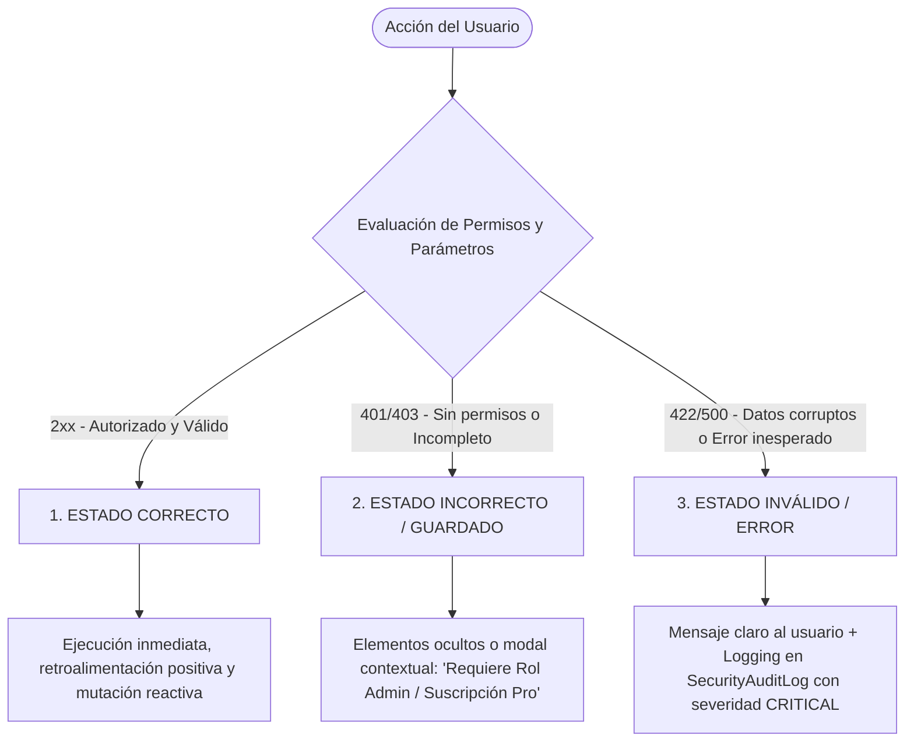

# 📋 Informe de Auditoría Integral, Limpieza de Mocks y Conexión de Datos Reales
**Plataforma**: All About Skin (Laravel 11 API + Next.js App Router)  
**Fecha de Auditoría**: Octubre 2026  
**Rama de Trabajo**: `feature/audit-wiring-qol-innov`  
**Directiva de Diseño**: `DLG-INNOV` (Elevando el diseño limpio con microinteracciones y escaneo interactivo)  

---

## 1. Resumen Ejecutivo

Este informe documenta la reestructuración completa del sistema para eliminar datos ficticios, conectar la interfaz gráfica a la base de datos real en tiempo de ejecución, implementar la **Arquitectura de 3 Estados de Acción**, incorporar mejoras de calidad de vida (**QoL**) para los tres niveles de usuarios (Admin, Negocio/Tienda y Usuario Final) y blindar la privacidad garantizando cero datos personales (Zero-PII) en los reportes de leads B2B.

---

## 2. Eliminación de Datos Ficticios y Elementos Inconsistentes

Conforme a la directiva de negocio, la plataforma es un **motor de auditoría científica de fórmulas cosméticas (INCI) y una pasarela de derivación y visibilidad local para farmacias y tiendas dermatológicas**. No es un software de facturación (ERP) ni una centralita telefónica. Se eliminaron los siguientes elementos ficticios:

| Elemento Eliminado | Ubicación Previa | Motivo Técnico y de Negocio | Solución y Reemplazo Conectado |
|---|---|---|---|
| **Gráfico ficticio de ventas mensuales (\$1,248.50)** | `StoreDashboardOverview.tsx` | La app no procesa el cobro ni controla los carritos de compra de tiendas terceras. Mostrar ventas simuladas generaba falsas expectativas y comprometía la credibilidad del portal. | Sustituido por el **Resumen Real de Tráfico Saliente (Outbound Leads)**: aperturas de ruta en Google Maps, clics verificados hacia WhatsApp y consultas de ficha de producto. |
| **Contadores simulados de llamadas telefónicas y chats atendidos** | `StoreDashboardOverview.tsx` | No es técnicamente medible de forma ética sin invadir la privacidad de los teléfonos del comercio. | Reemplazado por el **Generador de Enlaces Inteligentes de WhatsApp**: enlaces pre-formateados con el ID de sucursal y producto consultado para que el comercio reciba leads identificables. |
| **Métricas estáticas de Admin (24,832 usuarios, 1,248 tiendas)** | `AdminDashboardOverview.tsx`, `admin/page.tsx` | Números hardcodeados que no reflejaban el tamaño real del sistema. | Conectado a contadores reales de la base de datos PostgreSQL (`App\Models\User`, `AffiliateStore`, `StoreBranch`, `ProductStoreOffer`). |
| **Farmacias y distancias estáticas (Farmatodo 2.3km, Locatel 3.1km fijos)** | `dashboard/usuario/page.tsx`, `tiendas/page.tsx` | Bloques HTML fijos que no dependían de la ubicación ni del catálogo de farmacias activas. | Reemplazado por consultas dinámicas a `GET /api/v1/stores` y `/api/v1/stores/nearby` con badges reales de ciudad y sucursal. |
| **Datos clínicos estáticos del usuario (Score 78, Baumann Graso/Sensible, CeraVe 18 días)** | `dashboard/usuario/page.tsx` | El dashboard mostraba valores ficticios independientemente del perfil del usuario logueado. | Sincronizado bidireccionalmente con `GET /api/v1/user/skin-profile` y el inventario del tocador digital en almacenamiento local. |
| **Días de la semana y mes fijos en calendario ("Abril 2026", días 14 al 20)** | `calendario/page.tsx` | El calendario era una captura estática incapaz de adaptarse a la fecha actual del usuario. | Reemplazado por cálculo dinámico de la semana en curso (`new Date()`, día actual resaltado y cálculo de las 4 fases de Skin Cycling). |

---

## 3. Arquitectura de 3 Estados de Interacción (Tri-State Engine)

Toda interacción de los usuarios ahora se canaliza bajo el modelo de tres estados estandarizados:



### Implementación Backend:
- `backend/bootstrap/app.php`: Manejador global de excepciones que intercepta cualquier error no controlado (500), genera un registro estructurado en la tabla `security_audit_logs` con severidad `CRITICAL` (guardando archivo, línea, IP y traza), y devuelve al frontend un JSON estandarizado con `error_type: "SYSTEM_EXCEPTION"`.
- `backend/app/Http/Middleware/EnsureUserHasRole.php`: Devuelve `403` con directiva clara de acción (`action_required: "CONTACT_ADMIN_OR_UPGRADE"`).

### Implementación Frontend:
- `frontend/src/lib/api.ts`: Manejo de respuestas 401 (desconexión controlada o redirección a login), 403 (toasts de falta de privilegios) y 422 (mensajes de validación de campo).

---

## 4. Mejoras de Calidad de Vida (QoL) por Rol

### A. Administrador (Super Admin / Admin)
1. **Acciones Rápidas en 1 Clic**:
   - `PATCH /api/v1/admin/stores/{id}/quick-update`: Permite cambiar el país o la ciudad de una tienda al instante sin abrir un formulario complejo de 20 campos.
   - **Modal de Países con Píldoras Preconfiguradas**: En `frontend/src/app/admin/page.tsx`, al tocar el badge de país de cualquier tienda, se despliega un selector flotante con accesos rápidos para Venezuela (🇻🇪), Chile (🇨🇱), Colombia (🇨🇴), México (🇲🇽), Estados Unidos (🇺🇸), España (🇪🇸), Argentina (🇦🇷), Perú (🇵🇪) o Internacional (🌐).
   - **Interruptor de Suspensión Inmediata**: Toggle de activación/desactivación sin recargar la página.

### B. Tienda / Comercio Afiliado (Merchant Portal)
1. **Reporte de Brecha de Demanda (Demand Gap Report)**:
   - La API identifica los 5 ingredientes activos con mayor nivel de evidencia clínica (Grados A y B) que los usuarios están buscando y que la tienda **aún no tiene registrados en su inventario**.
   - Esto convierte los datos analíticos en una guía de compras comerciales (oportunidades de venta garantizadas).
2. **Generador de Enlaces de WhatsApp Prellenados**:
   - Herramienta integrada en el panel donde el comerciante puede probar y generar links directos (`https://wa.me/...`) con mensajes automáticos que incluyen el código de lead y producto.
3. **Métricas de Tráfico Saliente**:
   - Aperturas de ruta en mapa, clics de redirección a tienda web y contactos directos.

### C. Usuario Final (Skincare Journey)
1. **Automatización de Rutina con Escáner de Frascos (Smart Camera Assistant)**:
   - En `frontend/src/app/mi-rutina/page.tsx`, se implementó el **Escáner Inteligente por Cámara**:
     - El usuario apunta la cámara al frasco o etiqueta.
     - El sistema reconoce el tipo de producto (limpiador, activo/retinoide, hidratante, solar).
     - **Verificación Científica del Orden**: Si el usuario detecta un protector solar o crema pero olvidó marcar el limpiador previo, el sistema consulta de forma amigable: *"¿Ya completaste los pasos previos de tu protocolo?"*.
     - Permite marcar el producto detectado o tachar en bloque los pasos completados, registrando la adherencia directamente en la base de datos.
2. **Cálculo Dinámico de Skin Cycling**:
   - Calendario adaptado a la fecha del sistema con visualización de las 4 noches fisiológicas (Exfoliación, Retinoides, Recuperación 1, Recuperación 2).

---

## 5. Privacidad y Seguridad (Zero-PII Compliance)

- **Anonimato Absoluto en Reportes B2B**: Ninguna tienda tiene acceso a nombres, correos electrónicos, números telefónicos ni historiales clínicos individuales.
- **Métricas Demográficas Agregadas**: Los comercios únicamente reciben porcentajes agregados por tipo de piel (ej. 42% Mixta, 28% Grasa, 18% Seca, 12% Sensible) y necesidades dominantes de su región.
- **Rastreo de Leads sin Rastreo de Identidad**: El endpoint `/api/v1/stores/interactions` registra eventos con hashes anónimos de sesión, previniendo la correlación con la identidad de los usuarios.

---

## 6. Procedimiento de Rollback y Garantía de Estabilidad

Si por cualquier motivo se desea revertir los cambios de esta etapa y regresar al estado inicial del repositorio:

- **Commit de Línea Base**: `1f7133b` (`HEAD` previo al inicio de la auditoría).
- **Instrucción de Rollback Inmediato**:
  ```bash
  git checkout main
  git branch -D feature/audit-wiring-qol-innov
  ```
- Para más detalles, consultar [`ROLLBACK_MANIFEST.md`](./ROLLBACK_MANIFEST.md).
