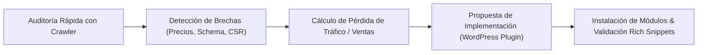

# INFORME TÉCNICO: ANÁLISIS DE FRICCIÓN EN E-COMMERCE (VENEZUELA & LATAM)
## Framework de Auditoría SEO, Gobernanza de Datos y Hoja de Ruta para Plugin de WordPress

> **Destinatarios:** Agente Autónomo de Desarrollo (Proyecto WordPress Plugin) | Consultor SEO Técnico | Arquitecto de Software  
> **Fecha:** Octubre 2026  
> **Estado:** Documento Maestro Operativo y de Arquitectura  

---

## 1. INTRODUCCIÓN Y CONTEXTO OPERATIVO

Durante el diseño y despliegue de los motores de crawling e ingestión de datos para la aplicación (caso de estudio: plataformas de salud, farmacia y cosmética como Farmatodo, Locatel, Farmahorro, Shopify independientes y tiendas WooCommerce en Venezuela y la región), se han identificado severas fallas estructurales, semánticas y de renderizado en las tiendas en línea.

Estas deficiencias generan un doble impacto crítico:
1. **Para la tienda (Impacto de Negocio y SEO):** Pérdida masiva de indexabilidad en Google, ausencia de rich snippets en SERP, invisibilidad en motores de búsqueda generativa (AEO/GEO: Gemini, ChatGPT Search, Perplexity) y carritos abandonados por discrepancias de precios/monedas.
2. **Para sistemas externos (Scraping, Agregadores y Partners):** Inestabilidad en la extracción, bloqueos involuntarios por WAF, dificultad para reconciliar inventarios multicursal y parsing erróneo de precios en economías multimoneda.

El propósito de este documento es servir como **especificación maestra** para que el **Agente IA del proyecto del plugin de WordPress**:
- Comprenda la anatomía de los problemas reales encontrados en campo.
- Audite el impacto de las soluciones técnicas existentes.
- Facilite al consultor SEO la creación de propuestas comerciales y auditorías auditables.
- Guíe el diseño e implementación de nuevos módulos dentro del plugin de WordPress.

---

## 2. TAXONOMÍA DE PROBLEMAS ENCONTRADOS EN CAMPO

```
                                 FALLAS E-COMMERCE EN CAMPO
                                              │
         ┌───────────────────┬────────────────┴──────────────────┬──────────────────┐
         ▼                   ▼                                   ▼                  ▼
1. Multimoneda y Precios 2. Renderizado / DOM           3. Semántica & Schema   4. Inventario Multisede
   - Confusión VES vs USD   - CSR vacío (React/Next)       - Schema roto/duplicado - Stock por sucursal oculto
   - Puntuación (.,)        - Hydration Mismatch           - Falta de Product/Offer- Dependencia de cookies
   - Desglose Base + IVA    - Bloqueo WAF indiscriminado   - Precios desincronizados- Geolocalización forzada
```

### 2.1. Desastre de Precios, Multimoneda y Puntuación Numérica
- **Ausencia de normalización ISO 4217:** Uso indistinto de símbolos ("$", "Ref", "Bs.", "Bs", "VES", "USD"). Muchas tiendas muestran "$" cuando el precio está expresado en Bolívares soberanos/digitales, induciendo a Googlebot a catalogar productos con precios 30x a 50x menores o mayores.
- **Inconsistencia de separadores decimales y miles:**
  - Estándar local venezolano/europeo: `1.450,50` (Punto = millar, Coma = decimal).
  - Estándar anglosajón/APIs: `1450.50` (Coma = millar, Punto = decimal).
  - Sitios web que mezclan ambos formatos en una misma ficha técnica (ej. Base imponible en formato anglosajón y precio final con IVA en formato venezolano).
- **Opacidad en impuestos (IVA 16% / IGTF):** Plataformas como VTEX almacenan en `commertialOffer` el precio neto (`Price`) y el impuesto (`Tax`) por separado. Si la tienda no consolida esto en el HTML o en JSON-LD, el scraper y los motores de búsqueda extraen el precio sin IVA, generando una discrepancia legal y comercial ante el comprador.

### 2.2. Trampa de Renderizado del Lado del Cliente (CSR) y Agotamiento de Crawl Budget
- **Single Page Applications (SPAs) sin SSR:** Tiendas montadas en React/Next/Vue donde el HTML inicial entregado al bot es un `<!DOCTYPE html><html><body><div id="root"></div></body></html>`.
- **Agotamiento del presupuesto de rastreo (Crawl Budget):** Googlebot posterga la segunda fase de renderizado (WRS - Web Rendering Service) por días o semanas. Para motores de IA como Perplexity o GPTBot, el producto simplemente **no existe**.
- **WAF y Cloudflare hostiles:** Reglas de WAF mal configuradas que bloquean solicitudes `HTTP/1.1` o user-agents de scraping legítimo, pero al mismo tiempo no ofrecen feeds estructurados ni API pública, aislando la tienda del ecosistema de búsqueda moderna.

### 2.3. Ruina Semántica y Datos Estructurados (Schema.org / JSON-LD)
- **JSON-LD ausente, roto o incompleto:** Menos del 25% de las tiendas analizadas cuentan con un nodo `schema.org/Product` válido con especificación completa de `offers`, `priceCurrency`, `itemAvailability`, `sku`, y `brand`.
- **Colisión de Plugins:** En WordPress/WooCommerce es frecuente encontrar 3 bloques JSON-LD distintos (uno inyectado por el tema, otro por un plugin de SEO genérico como Yoast/RankMath, y otro por WooCommerce), cada uno indicando un precio o stock diferente.
- **Falta de Microdatos para AEO (Answer Engine Optimization):** Cero especificación de atributos enriquecidos como ingredientes activos (`activeIngredient`), modo de empleo, precauciones o certificaciones sanitarias, vitales para que los motores de IA recomienden el producto.

### 2.4. Desarticulación de Inventarios Físicos y Multisede (Branch Inventory)
- **Disponibilidad geolocalizada no expuesta:** El stock depende de la sucursal seleccionada mediante un modal o una cookie de sesión (`vtex_segment` o cookie de sesión PHP). Para un bot de búsqueda, el producto figura como "Disponible" o "Sin Información", pero al llegar el usuario a comprar descubre que no hay disponibilidad en su ciudad.
- **Ausencia de marcado `availableAtOrFrom`:** No se aprovecha la propiedad de Schema.org para vincular ofertas a ubicaciones físicas geográficas (`Store` / `Place`).

---

## 3. IMPACTO TÉCNICO Y ECONÓMICO: MATRIZ DE EVALUACIÓN PARA EL AGENTE IA

El Agente IA del proyecto del plugin de WordPress debe utilizar esta matriz para auditar URLs de tiendas y calcular el **Índice de Madurez de Infraestructura E-Commerce (IMIE)**:

| Dimensión | Estado Crítico (Falla Común) | Estado Resuelto (Solución Plugin) | Impacto Cuantificable |
| :--- | :--- | :--- | :--- |
| **Indexación y Visibilidad** | CSR sin pre-renderizado. DOM vacío al primer byte. | Snapshot estático / SSR semántico inyectado vía plugin. | **+40% a +80%** de páginas indexadas en los primeros 14 días. |
| **Rich Snippets SERP** | Precios omitidos o marcados con moneda errónea (`$` en vez de `VES`/`USD`). | JSON-LD limpio con `AggregateOffer`, `priceSpecification` y tasa BCV. | **+20% a +35% CTR** en resultados de búsqueda orgánica. |
| **Conversión Comercial** | Usuario entra esperando un precio y ve otro por falta de IVA o tasa desactualizada. | Sincronización dinámica de doble precio (VES oficial BCV + USD Ref). | **-18%** de rebote inmediato y reducción de quejas al soporte. |
| **Rastreo LLM / AEO** | Bloqueo por Cloudflare WAF o contenido no parseable por IA. | Endpoint público de feed estructurado (`/wp-json/catalog/feed` o Markdown semántico). | Presencia en respuestas citadas por ChatGPT, Perplexity y Gemini. |
| **Inventario Multisede** | Stock oculto tras cookies de sucursal. | Esquema `StoreBranch` con disponibilidad distribuida por ciudad. | Posicionamiento en búsquedas locales (*"Ácido Hialurónico Caracas / Valencia"*). |

---

## 4. MARCO ESTRATÉGICO PARA EL ASESOR SEO (GENERADOR DE PROPUESTAS)

Para que el usuario actúe como **Asesor de SEO Técnico de Alto Valor**, las propuestas comerciales deben estructurarse bajo el modelo **Diagnóstico -> Pérdida Financiera -> Solución Tecnológica -> Medición de Retorno (ROI)**.



### 4.1. Estructura de la Propuesta de Auditoría SEO E-Commerce

1. **Diagnóstico Forense Automatizado:**
   - Reporte de rastreabilidad: ¿Qué ve Googlebot en el HTML crudo frente al navegador?
   - Validación de Microdatos Schema.org ante la herramienta oficial de Rich Results de Google.
   - Auditoría de inconsistencia cambiaria (Moneda ISO vs. Símbolo visual).
2. **Impacto en el Negocio (Lenguaje del Cliente):**
   - *"Su tienda no aparece con estrellas, precios ni disponibilidad en Google porque sus datos estructurados están rotos o desfasados."*
   - *"Los motores de búsqueda de IA no pueden recomendar sus productos en Venezuela porque su web requiere interacción manual con un modal para ver el precio real en Bolívares."*
3. **Plan de Remediación Técnica:**
   - Implementación del plugin de optimización semántica y gobernanza de catálogo.
   - Normalización de precios duales con actualización automática contra tasa oficial.
   - Creación de sitemaps especializados y microdatos enriquecidos por sucursal.

---

## 5. HOJA DE RUTA Y ARQUITECTURA PARA EL PLUGIN DE WORDPRESS

Para que el **Desarrollador** y el **Agente IA del Plugin** creen soluciones definitivas, el plugin debe estructurarse en **6 Módulos de Alto Impacto**:

```
                         ARQUITECTURA DEL PLUGIN WORDPRESS
┌─────────────────────────────────────────────────────────────────────────────┐
│ 1. MÓDULO MULTIMONEDA & BCV ENGINE                                          │
│    - Normalización de precios (VES / USD) con redondeo configurable.        │
│    - Inyección de tasas oficiales BCV / alternativas con cache transitorio. │
├─────────────────────────────────────────────────────────────────────────────┤
│ 2. MÓDULO ADVANCED SCHEMA.ORG ARCHITECT (JSON-LD)                            │
│    - Nodo centralizado Product + AggregateOffer (Desglose de IVA).          │
│    - Limpieza automática de Schemas duplicados de temas o plugins terceros.│
├─────────────────────────────────────────────────────────────────────────────┤
│ 3. MÓDULO INVENTARIO MULTISUCURSAL & LOCAL SEO                              │
│    - Modelado de Sedes (Caracas, Valencia, Maracaibo, Barquisimeto, etc.).  │
│    - Marcado `hasMerchantReturnPolicy` y `availableAtOrFrom` por sucursal.  │
├─────────────────────────────────────────────────────────────────────────────┤
│ 4. MÓDULO CRAWLER-FRIENDLY SSR / PRE-RENDER GUARD                           │
│    - Detección de bots legítimos (Googlebot, Bing, GPTBot, Perplexity).     │
│    - Servido de snapshot semántico HTML ultraliviano sin JavaScript pesado. │
├─────────────────────────────────────────────────────────────────────────────┤
│ 5. MÓDULO FEED GENERATOR PARA LLMs & CATÁLOGOS EXTERNOS                     │
│    - Feeds JSON / XML optimizados para Google Merchant Center y LLMs.       │
│    - Endpoint `/wp-json/skin-catalog/v1/product/{id}` ultra-optimizado.     │
├─────────────────────────────────────────────────────────────────────────────┤
│ 6. MÓDULO CANONICAL & FACETED SEARCH HYGIENE                                │
│    - Neutralización de parámetros duplicados (?sort=, ?color=, ?page=).     │
│    - Auto-generación de etiquetas canonicals y paginación rel="prev/next".  │
└─────────────────────────────────────────────────────────────────────────────┘
```

### 5.1. Módulo 1: Motor Cambiario y Normalización Monetaria
- **Responsabilidad:** Garantizar que WooCommerce y el frontend muestren y expongan a nivel de código precios inequívocos.
- **Implementación Técnica:**
  - Hook en `woocommerce_get_price_html` y filtros de cálculo de carrito.
  - Almacenamiento del precio base (ej. USD o VES) y cálculo dinámico mediante transitorios de WordPress (`wp_cache_get` / `get_transient`).
  - Formateo estricto: Manejo de miles con punto y decimales con coma en presentación visual, pero exportación numérica limpia (`1234.56`) en metadatos para crawlers.

### 5.2. Módulo 2: Motor de JSON-LD Universal y Desglose Fiscal
- **Responsabilidad:** Eliminar el JSON-LD conflictivo de WooCommerce / Yoast y reemplazarlo con un bloque Schema.org canónico e integral.
- **Estructura del Schema Generado por el Plugin:**
```json
{
  "@context": "https://schema.org",
  "@graph": [
    {
      "@type": "Product",
      "@id": "https://tienda.com/producto/serum-vitamina-c/#product",
      "name": "Serum Facial Vitamina C 15%",
      "description": "Tratamiento antioxidante para luminosidad y unificación del tono.",
      "sku": "VITC-001",
      "brand": {
        "@type": "Brand",
        "name": "Dra. Piel"
      },
      "offers": {
        "@type": "AggregateOffer",
        "priceCurrency": "USD",
        "lowPrice": "25.00",
        "highPrice": "25.00",
        "offerCount": "1",
        "priceSpecification": [
          {
            "@type": "UnitPriceSpecification",
            "price": "25.00",
            "priceCurrency": "USD",
            "valueAddedTaxIncluded": true
          },
          {
            "@type": "UnitPriceSpecification",
            "price": "980.50",
            "priceCurrency": "VES",
            "valueAddedTaxIncluded": true
          }
        ],
        "availability": "https://schema.org/InStock",
        "url": "https://tienda.com/producto/serum-vitamina-c/"
      }
    }
  ]
}
```

### 5.3. Módulo 3: Disponibilidad Multisede (Branch Inventory)
- **Responsabilidad:** Mapear tiendas físicas y su inventario local para enriquecer las búsquedas locales en Google.
- **Implementación:**
  - Taxonomía personalizada `store_branch` (Sedes físicas).
  - Inyección en el `Offer` de la propiedad `availableAtOrFrom`:
```json
"availableAtOrFrom": [
  {
    "@type": "Store",
    "name": "Sede Las Mercedes",
    "address": {
      "@type": "PostalAddress",
      "addressLocality": "Caracas",
      "addressCountry": "VE"
    }
  }
]
```

### 5.4. Módulo 4: Pre-render / Bot-Shield Inteligente
- **Responsabilidad:** Garantizar que los scrapers, bots de redes sociales y crawlers de IA obtengan una versión HTML estática e hiper-semántica en menos de 200 ms, sin ejecutar JavaScript pesado ni activar falsos positivos en el firewall.

---

## 6. PROTOCOLO DE EJECUCIÓN PARA EL AGENTE IA (INSTRUCCIONES DIRECTAS)

Cuando pases este documento a tu Agente IA en el repositorio de tu plugin de WordPress, infórmale lo siguiente:

> **Prompt de Activación para el Agente del Plugin:**
> *"Agente, lee detenidamente este Informe Técnico de Fricción en E-Commerce. Tu objetivo es:
> 1. Verificar cómo el código actual de nuestro plugin maneja la generación de JSON-LD, la presentación de precios multimoneda (VES/USD) y la compatibilidad con WooCommerce.
> 2. Comparar nuestras funciones contra la Taxonomía de Problemas identificada en las tiendas de Venezuela y LatAm (ver Sección 2).
> 3. Implementar o refactorizar nuestros hooks de WooCommerce para cumplir con el esquema unificado de la Sección 5 (Schema multimoneda con desglose de impuestos, control de canonicals y exposición semántica para crawlers).
> 4. Diseñar los tests unitarios y de integración para validar que los endpoints de exportación y los metadatos HTML sean 100% tolerantes a fallos en separadores decimales y cambios de tasa cambiaria."*

---

## 7. CONCLUSIÓN Y BENEFICIO COMPETITIVO

Este framework transforma una debilidad generalizada del mercado en una **ventaja competitiva asimétrica**:
- **Como Asesor SEO:** Puedes auditar tiendas de clientes potenciales, demostrar con datos empíricos por qué están perdiendo tráfico ante el desastre de su renderizado y datos estructurados, y ofrecerles una solución inmediata.
- **Como Desarrollador de Plugin:** Creas un producto que resuelve problemas reales que plugins globales como Yoast, RankMath o WooCommerce oficial ignoran por completo (economías bimonetarias, volatilidad cambiaria, impuestos desglosados y stock por sucursales en países emergentes).
